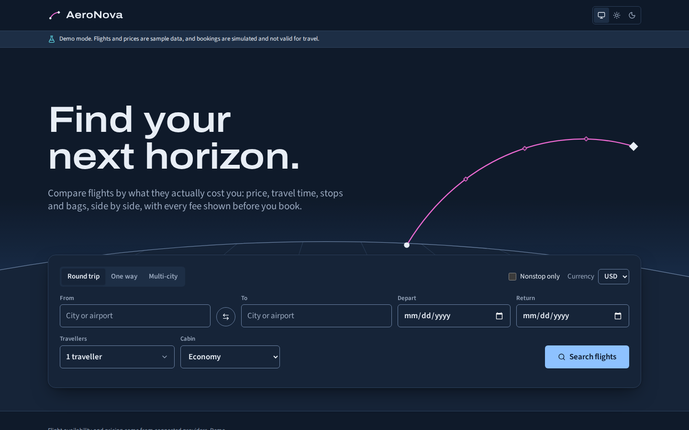

# AeroNova

AeroNova is a flight discovery, comparison, and booking-journey demo. Render deploys the React frontend and Express API together as one web service; MongoDB Atlas can persist account and search data.

The active deployment path is one Render web service. The application has no AWS or Lambda runtime dependency.



## Status

The app can be hosted on Render as one service. Its hosted runtime uses production Node settings with demo application mode; it is not enabled for real airline sales.

- Frontend: Vite SPA served by Express
- API: Express app for Node.js hosting
- Data: MongoDB Atlas recommended for production persistence
- Auth: app-managed email/password sign-in for the demo
- Deployment path: one Render web service from the repository root

## Quick start

Requirements: Node 22.22+ and npm 11.

**Windows (PowerShell)**

```powershell
npm ci
npm run dev
```

**macOS / Linux**

```bash
npm ci
npm run dev
```

Open http://localhost:5173. The API runs on http://localhost:4000.

## Scripts

| Command | What it does |
| --- | --- |
| `npm run dev` | Runs the API and web app together |
| `npm run build` | Builds the API and frontend |
| `npm test` | Runs the workspace test suite |
| `npm run typecheck` | Runs TypeScript checks |
| `npm run lint` | Lints the monorepo |
| `npm run verify` | Runs typecheck, lint, tests, and builds |

## Runtime modes

| APP_MODE | Purpose | Notes |
| --- | --- | --- |
| `demo` | Local development and product demo | Uses curated sample flight data |
| `test` | Supplier sandbox validation | Requires a Duffel test token |
| `production` | Not enabled | Requires production-grade authentication and real supplier integrations |

Demo mode does not require paid accounts.

## Configuration

The demo works locally with the defaults and does not require an environment
file. For Render deployment, use [render.yaml](render.yaml) and the
platform settings described in
[VERCEL_RENDER_DEPLOYMENT_GUIDE.md](docs/VERCEL_RENDER_DEPLOYMENT_GUIDE.md).
Only browser-safe values should use `VITE_` variables; secrets remain on the API.

## Architecture

| Layer | Choice |
| --- | --- |
| Web | React + Vite |
| API | Node.js + Express |
| Auth | App-managed email/password sign-in for demo mode |
| Data | MongoDB Atlas for persistent deployments |
| Hosting | Render serves frontend and API from one web service |
| Quality | TypeScript, ESLint, Vitest |

## Deployment documentation

- [VERCEL_RENDER_DEPLOYMENT_GUIDE.md](docs/VERCEL_RENDER_DEPLOYMENT_GUIDE.md)
- [PRODUCTION_READINESS_REPORT.md](docs/PRODUCTION_READINESS_REPORT.md)

## Project structure

```text
apps/api       Express API
apps/web       React frontend
packages/shared Shared domain types and schemas
docs/          Architecture, deployment, and migration docs
```

## Important constraints

- This project cannot issue real airline tickets without real provider approval and a valid commercial setup.
- No deployment or resource creation occurs automatically in this repo.
- Render production hosting requires a paid web service; see the deployment guide.
- Real flight search, booking, and payment features remain blocked unless valid credentials and provider agreements exist.

## License

Unlicensed, all rights reserved, until a license is chosen.
