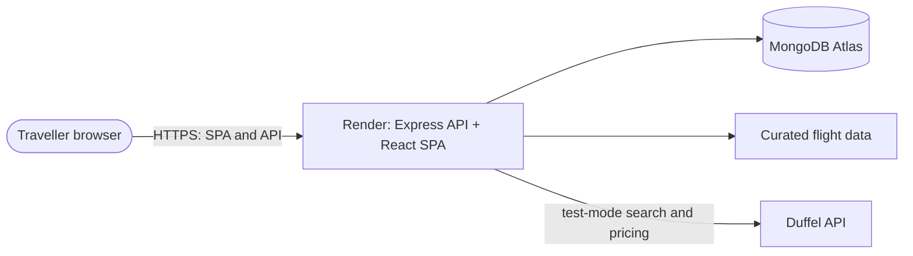

# Architecture

AeroNova is a modular monolith: a React single-page app, a Node.js/Express API,
and shared domain types and validation schemas. Render hosts the built web app
and API together in one Node web service.

## System overview



The local Vite server proxies `/api` and `/health` to the API. Hosted web builds
are served by Express from the same origin as `/api` and `/health`.

| Component | Responsibility |
| --- | --- |
| `apps/web` | React interface, route-level code splitting, browser-side search filters |
| `apps/api` | Express HTTP API, authentication, flight search/pricing, bookings and account services |
| `packages/shared` | Domain types, schemas, error codes, money and date primitives |
| MongoDB | Persistent accounts, saved searches, audit events, searches and quotes |
| Render | Express API and static SPA hosting |

## Runtime modes

| `APP_MODE` | Flight source | Authentication | Availability |
| --- | --- | --- | --- |
| `demo` | Curated mock data | App-managed email/password | Supported |
| `test` | Duffel test API | App-managed email/password | Supported for supplier validation |
| `production` | Live supplier data | Requires production-grade authentication | Intentionally rejected by API configuration |

The demo authentication provider hashes passwords with scrypt and signs
short-lived bearer tokens. It is intentionally restricted to demo/test modes;
the hosted Render deployment uses `APP_MODE=demo`. Production mode remains
blocked until a production-grade identity and account-recovery flow is chosen.

The booking, payment and ticketing providers are simulators. Booking can be
enabled only when flight data is also simulated; real supplier offers are never
presented as booked through the simulator.

## Backend layering

```text
HTTP request
  → route and authentication middleware
  → application service
  → domain logic
  → repository interfaces → MongoDB or in-memory implementation
  → provider interfaces → mock or Duffel implementation
  → response mapper
```

Controllers translate HTTP only. Supplier response shapes stay in provider
adapters; Mongoose models stay in repository implementations. Offer IDs
returned to the browser are AeroNova IDs, while supplier offer references stay
server-side for price checks and booking.

MongoDB is optional in local/demo mode. Without `MONGODB_URI`, account and
search data use process memory and are lost on restart. Persistent deployments
should configure MongoDB Atlas and allow network access from the API host.

## Build and run

- `npm run dev` starts the API and Vite development server.
- `npm run build` bundles the API for Node.js hosting and builds the static web
  app.
- The API starts from `apps/api/src/server.ts`; it has no Lambda adapter or
  AWS-specific runtime.
- See [the single-service Render deployment guide](./VERCEL_RENDER_DEPLOYMENT_GUIDE.md)
  for hosted configuration.
